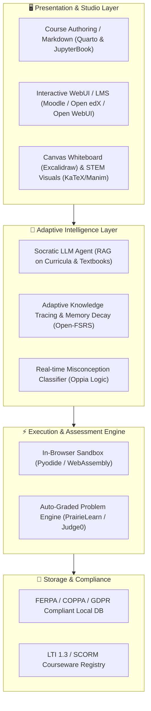

# 🎓 Awesome EdTech & Interactive AI Learning Studio

  <strong>A curated collection of industry-leading SaaS platforms and open-source GitHub projects powering next-generation AI tutoring, adaptive learning engines, interactive courseware studios, and self-hosted LMS architectures.</strong>

  
  
  
  
  
  
  
  

  <a href="#-sector-overview--market-dynamics">Sector Overview</a> •
  <a href="#-saashosted-platforms">SaaS Platforms</a> •
  <a href="#-open-source-github-projects">Open-Source Projects</a> •
  <a href="#-interactive-sandboxes--stem-tools">Sandboxes & STEM</a> •
  <a href="#-core-architecture-frameworks">Studio Architecture</a> •
  <a href="#-how-to-contribute">Contribute</a>

---

## 📌 Overview & Scope

The modern educational landscape is rapidly evolving from static digital textbooks into **AI-native learning studios** and **adaptive mastery ecosystems**. This repository curates state-of-the-art tools and frameworks across:

- 🤖 **Socratic AI Tutors & Conversational Coaches**: Intelligent teaching assistants offering step-by-step guidance without hallucinating answers.
- 📈 **Cognitive Mastery & Adaptive Engines**: Algorithms adjusting pacing, scaffolding, and difficulty based on real-time student performance (e.g., FSRS, Bayesian Knowledge Tracing).
- 💻 **Interactive Browser Sandboxes**: Zero-install Python, Linux, and JavaScript sandboxes with automated unit tests and instant auto-grading.
- 🏛️ **Self-Hosted Open-Source LMS**: Full data sovereignty, zero per-student licensing fees, and compliance with institutional standards (FERPA, COPPA, GDPR, LTI 1.3, SCORM).
- 🎬 **AI Educational Media & Lecture Generation**: Text-to-speech lecture synthesizers, avatar video generators, and programmatic math animation tools.

---

## 📑 Table of Contents

- [📌 Overview & Scope](#-overview--scope)
- [📊 Sector Overview & Market Dynamics](#-sector-overview--market-dynamics)
- [☁️ SaaS/Hosted Platforms](#️-saashosted-platforms)
- [💻 Open-Source GitHub Projects](#-open-source-github-projects)
  - [🏢 Open-Source Learning Management Systems (LMS)](#-open-source-learning-management-systems-lms)
  - [🧠 AI Learning Studios, Tutors & Knowledge Assistants](#-ai-learning-studios-tutors--knowledge-assistants)
  - [🔄 Spaced-Repetition & Memory Retention Engines](#-spaced-repetition--memory-retention-engines)
  - [📖 Interactive Courseware & Open Textbooks](#-interactive-courseware--open-textbooks)
  - [📐 STEM, Math Animation & Problem-Driven Assessment](#-stem-math-animation--problem-driven-assessment)
- [🛠️ Interactive Sandboxes & STEM Tools](#️-interactive-sandboxes--stem-tools)
- [🏗️ Core Architecture Frameworks](#️-core-architecture-frameworks)
- [🤝 How to Contribute](#-how-to-contribute)
- [⚖️ License & Disclaimer](#️-license--disclaimer)

---

## 📊 Sector Overview & Market Dynamics

The global EdTech and Smart Classroom market is projected to expand from approximately **$145 billion in 2023 to over $400 billion by 2030**, clocking a compound annual growth rate (CAGR) of ~16.5%. The sector exhibits **moderate fragmentation with specialized sub-segment concentration**: consumer language learning and broad MOOC ecosystems lean toward high concentration around dominant brand networks (e.g., Duolingo, Coursera), whereas institutional K–12 adaptive learning, corporate L&D studios, and self-hosted open-source LMS deployments remain highly fragmented due to regional accreditation rules, national curricula, and strict student data privacy mandates (FERPA/COPPA/GDPR).

---

## ☁️ SaaS/Hosted Platforms

The table below catalogs premier commercial and hosted EdTech studios, sorted in descending order by **Company Scale (Market Cap / Valuation / Annual Revenue)**:

| 🏷️ Product | 🏢 Company Scale (Valuation / Revenue) | 💡 Key Focus & Capabilities | 💰 Pricing (Specific Starting Tiers) | 🎁 Free Tier / Free Trial Limits |
| :--- | :--- | :--- | :--- | :--- |
| **[Duolingo](https://duolingo.com)** | **~$6.9B Market Cap** (~$1.04B Annual Revenue) | Gamified language, math, and literacy learning powered by spaced-repetition algorithms and Duolingo Max generative AI roleplays. | Starting at **$6.99/mo** (Super Duolingo annual billing) or **$12.99/mo** (monthly); **$29.99/mo** (Duolingo Max with GPT-4 tutor roleplay and answer explanations). | **Free plan forever**: Ad-supported with a 5-heart daily energy pool and standard lesson tracks. |
| **[Synthesia Education](https://synthesia.io)** | **~$4.0B Valuation** (~$150M ARR) | Generative AI video studio turning curriculum text and scripts into multilingual, avatar-led educational video lessons. | Starting at **$29/mo** (Starter tier, billed monthly or $216/yr) with 120 minutes of video per year and 1 editor seat. | **Free plan forever**: Limited to 3 minutes of generated video per month, 9 AI avatars, and 120+ languages with Synthesia watermark. |
| **[Sana Labs](https://sanalabs.com)** | **~$1.1B Valuation** (~$60M ARR; acquired by Workday) | AI-native enterprise learning studio combining personalized adaptive pathways, course authoring, and RAG knowledge assistants. | Starting at **$7.20/user/month** (Team plan, minimum 10 users) for interactive course creation and AI search. | **14-day free trial**: Full access to authoring studio and AI knowledge assistant for up to 10 users with zero credit card required. |
| **[Coursera](https://coursera.org)** | **~$920M Market Cap** (~$757M Annual Revenue) | Global online learning platform partnering with 300+ universities to deliver accredited degrees, labs, and Coursera Coach AI tutoring. | Starting at **$59/month** or **$399/year** (Coursera Plus subscription for unlimited certificates across 7,000+ courses). | **Free plan forever (Audit mode)**: Unlimited free access to video lectures and readings across 5,000+ courses (excludes graded assignments and certificates). |
| **[Carnegie Learning (MATHia)](https://carnegielearning.com)** | **~$250M Annual Revenue** (PE-backed by MDP) | AI-powered K–12 adaptive curriculum and intelligent tutoring software (MATHia) offering cognitive step-by-step hints and mastery pacing. | Starting at **$20/student/year** (MATHia standalone software license for accredited K–12 schools). | **30-day institutional trial**: Full pilot access for up to 2 classrooms (60 students) with teacher analytics dashboard. |
| **[Khan Academy & Khanmigo](https://khanacademy.org)** | **~$150M Net Assets** (~$118M Annual Revenue; 501(c)(3)) | Non-profit mastery learning platform with Khanmigo, a Socratic AI-powered student tutor and lesson-planning assistant. | **$4/month** or **$44/year** for individual student Khanmigo AI; free for verified US teachers; $10/student/year for district integrations. | **Free plan forever**: 100% of Khan Academy core exercises, courses, and teacher dashboards are completely free with zero limits; Khanmigo includes a 7-day free trial. |
| **[DreamBox Learning](https://dreambox.com)** | **~$100M+ Annual Revenue** (Acquired by Discovery Ed) | Intelligent adaptive K–8 math and reading platform continuously analyzing student in-lesson problem-solving strategies. | Starting at **$12.95/month** or **$99.95/year** for direct family home subscriptions; district licenses start at ~$15/student/year. | **14-day free trial**: Unrestricted access for up to 3 children across all K–8 math and reading modules; no commitment. |
| **[Knewton Alta (Wiley)](https://wiley.com)** | **~$17M Acquisition** (Subsidiary of John Wiley & Sons) | Mastery-based adaptive courseware for higher-education STEM, economics, and statistics delivering real-time remediation. | Starting at **$14.95/month** (Single-Course subscription) or **$49.95/term** (Single-Term course access code). | **14-day courtesy access trial**: Free full access for 14 calendar days at the start of any academic term while financial aid processes. |
| **[CENTURY Tech](https://century.tech)** | **~$16M Annual Revenue** (~$30M Total Funding) | AI-driven adaptive learning platform combining cognitive neuroscience and machine learning to tailor personalized study pathways. | Starting at **£12 to £18/student/year** (~$15–$23 USD/seat/yr, minimum institutional cohort of 100 students). | **30-day school evaluation pilot**: Free access for 1 subject cohort (up to 150 students and 5 teachers) with diagnostic onboarding. |
| **[Querium](https://querium.com)** | **~$6M Total Funding** (Series B Backed) | StepWise AI-powered virtual tutor providing step-by-step adaptive coaching and diagnostic feedback for STEM exams (TSI/SAT/ACT). | Starting at **$25/student/course** (institutional bulk software licensing for community colleges and districts). | **14-day sandbox access**: Teacher and department evaluator access with 5 pre-configured student diagnostic assessment paths. |

---

## 💻 Open-Source GitHub Projects

Below is a comprehensive collection of active open-source repositories for self-hosting AI learning studios, running offline LMS deployments, and embedding live browser sandboxes.

> 🌟 **Sorted by GitHub Stars (Descending)**. Star badges link directly to each repository's stargazers community.

### 🏢 Open-Source Learning Management Systems (LMS)

- **[Moodle (`moodle/moodle`)](https://github.com/moodle/moodle)** 🎓   
  *The world's most ubiquitous open-source Learning Management System.* Features modular course creation, competency-based tracking, grading workflows, LTI 1.3 standards, and an extensive ecosystem of community plugins (including OpenAI and local LLM tutor integrations).
- **[Open edX (`openedx/edx-platform`)](https://github.com/openedx/edx-platform)** 🌐   
  *Scalable, enterprise-grade MOOC platform founded by Harvard and MIT.* Powers millions of online learners worldwide with modular XBlocks, auto-graded coding problem sets, discussion forums, and rich institutional learning analytics.
- **[Canvas LMS (`instructure/canvas-lms`)](https://github.com/instructure/canvas-lms)** 🏫   
  *Modern open-source core behind higher-ed and K–12 institutions.* Provides an intuitive web UI, mobile apps, rubrics, speed-grader workflows, and deep external tool interoperability.
- **[Sakai (`sakaiproject/sakai`)](https://github.com/sakaiproject/sakai)** 🏛️   
  *University-designed open-source learning environment.* Built specifically for higher education teaching, academic research collaboration, and comprehensive grading rubrics.
- **[Kolibri (`learningequality/kolibri`)](https://github.com/learningequality/kolibri)** 📡   
  *Offline-first educational studio and LMS engineered for low-connectivity environments.* Distributes curated Khan Academy, OpenStax, and custom interactive exercises over local Wi-Fi without internet access.
- **[Chamilo LMS (`chamilo/chamilo-lms`)](https://github.com/chamilo/chamilo-lms)** 📑   
  *Lightweight, accessible e-learning system.* Emphasizes fast course authoring, SCORM compliance, skill-based tracking, and straightforward classroom administration.

### 🧠 AI Learning Studios, Tutors & Knowledge Assistants

- **[Open WebUI (`open-webui/open-webui`)](https://github.com/open-webui/open-webui)** 💬   
  *Self-hosted AI workspace with multimodal support.* Frequently deployed by educators and university labs to host Socratic AI tutors, local RAG textbook query engines, and voice tutoring agents with local LLMs (Ollama/vLLM).
- **[Open Notebook (`lfnovo/open-notebook`)](https://github.com/lfnovo/open-notebook)** 📓   
  *Privacy-first open-source alternative to Google NotebookLM.* Enables students and teachers to upload lecture slides and textbooks, chat with synthesized notes, and produce auto-generated audio discussions.
- **[Khoj (`khoj-ai/khoj`)](https://github.com/khoj-ai/khoj)** 🧭   
  *Personal open-source AI study companion.* Indexes local Obsidian, Markdown, and PDF notes to craft custom adaptive quizzes, flashcards, and factual research assistants.
- **[SurfSense (`MODSetter/SurfSense`)](https://github.com/MODSetter/SurfSense)** 🔍   
  *Self-hosted AI research and knowledge engine.* Unifies research papers, lecture notes, and web references into an interactive, vectorized study workspace.
- **[Oppia (`oppia/oppia`)](https://github.com/oppia/oppia)** 💡   
  *Interactive conversational learning platform.* Delivers story-driven learning explorations that simulate one-on-one tutoring by directly diagnosing and addressing specific student misconceptions.
- **[Ekko Studio (`EKKOLearnAI/ekko-studio`)](https://github.com/EKKOLearnAI/ekko-studio)** 🤖   
  *Modern open-source interactive AI learning studio.* Designed for building AI-assisted tutoring experiences, dynamic question generation, and adaptive study workflows.

### 🔄 Spaced-Repetition & Memory Retention Engines

- **[Logseq (`logseq/logseq`)](https://github.com/logseq/logseq)** 🧠   
  *Privacy-centric, local-first knowledge graph.* Combines networked note-taking with built-in spaced-repetition flashcards and side-by-side PDF annotation for deep academic study.
- **[Anki (`ankitects/anki`)](https://github.com/ankitects/anki)** 🗂️   
  *The gold standard in active-recall and spaced-repetition software.* Cross-platform flashcard system supporting LaTeX, audio clips, image occlusion, and modern neural retention models.
- **[Open-FSRS (`open-spaced-repetition/fsrs4anki`)](https://github.com/open-spaced-repetition/fsrs4anki)** 📈   
  *Free Spaced Repetition Scheduler (FSRS).* Machine-learning-based scheduling algorithm mathematically modeling memory decay to reduce review counts by 20–30% compared to traditional SM-2.

### 📖 Interactive Courseware & Open Textbooks

- **[freeCodeCamp (`freeCodeCamp/freeCodeCamp`)](https://github.com/freeCodeCamp/freeCodeCamp)** 💻   
  *World-renowned open-source interactive coding and math learning platform.* Features full in-browser coding environments, automated unit test validation, and structured project certifications.
- **[Quarto (`quarto-dev/quarto-cli`)](https://github.com/quarto-dev/quarto-cli)** 📊   
  *Next-generation scientific publishing system.* Creates interactive technical websites, slides, and WebAssembly-powered executable lessons from plain Markdown.
- **[JupyterBook (`jupyter-book/jupyter-book`)](https://github.com/jupyter-book/jupyter-book)** 📚   
  *Publication tool for computational courseware.* Compiles Jupyter Notebooks and Markdown into interactive, publication-quality online textbooks with embedded live code cells.
- **[LibreLingo (`LibreLingo/LibreLingo`)](https://github.com/LibreLingo/LibreLingo)** 🐢   
  *Community-owned, offline-capable language learning software.* An open-source, modular Duolingo alternative focused on community freedom and open linguistic data.
- **[H5P (`h5p/h5p-php-library`)](https://github.com/h5p/h5p-php-library)** 🧩   
  *Open-source HTML5 authoring library.* Enables teachers to create rich interactive videos, branching scenarios, crosswords, and drag-and-drop exercises directly within any LMS.
- **[LibreTexts / Adapt (`LibreTexts/adapt`)](https://github.com/LibreTexts/adapt)** 📖   
  *Open-source adaptive homework and assessment system.* Integrates auto-graded STEM questions, OER textbooks, and formative evaluation across multi-campus networks.

### 📐 STEM, Math Animation & Problem-Driven Assessment

- **[Excalidraw (`excalidraw/excalidraw`)](https://github.com/excalidraw/excalidraw)** 🎨   
  *Virtual hand-drawn collaborative whiteboard.* Widely embedded in live digital tutoring environments, collaborative problem solving, and visual diagramming.
- **[Manim (`ManimCommunity/manim`)](https://github.com/ManimCommunity/manim)** 🎬   
  *Python animation engine for explanatory math and physics.* Programmatically generates smooth vector animations and visual proofs popularized by 3Blue1Brown.
- **[KaTeX (`KaTeX/KaTeX`)](https://github.com/KaTeX/KaTeX)** 📐   
  *Fast math typesetting library for the web.* Renders complex mathematical formulas instantaneously without layout reflows or server-side pre-rendering.
- **[GeoGebra (`geogebra/geogebra`)](https://github.com/geogebra/geogebra)** 📏   
  *Interactive geometry, algebra, statistics, and calculus engine.* Powers interactive mathematical investigations and dynamic geometric modeling.
- **[PrairieLearn (`PrairieLearn/PrairieLearn`)](https://github.com/PrairieLearn/PrairieLearn)** 📝   
  *Problem-driven online homework and exam platform originated at UIUC.* Generates randomized, parameter-driven engineering, math, and computer science problem sets with instant auto-grading.
- **[SCORM API Wrapper (`pipwerks/scorm-api-wrapper`)](https://github.com/pipwerks/scorm-api-wrapper)** 📦   
  *Standardized e-learning wrapper.* Provides clean JavaScript abstractions to connect interactive modules and courseware with SCORM 1.2 and SCORM 2004 LMS engines.

---

## 🛠️ Interactive Sandboxes & STEM Tools

Essential open-source libraries for running client-side compilers, math rendering, and digital classroom features:

| 🏷️ Tool / Framework | ⭐ Stars Badge | 💡 Category & Capabilities |
| :--- | :---: | :--- |
| **[Whisper (`openai/whisper`)](https://github.com/openai/whisper)** |  | **Speech Recognition**: General-purpose speech recognition model for pronunciation assessment and automated lecture transcription. |
| **[WebVM (`leaningtech/webvm`)](https://github.com/leaningtech/webvm)** |  | **Client-Side Virtualization**: In-browser Linux virtual machine powered by WebAssembly and CheerpX for interactive systems programming labs. |
| **[Pyodide (`pyodide/pyodide`)](https://github.com/pyodide/pyodide)** |  | **Browser Python Sandbox**: WebAssembly port of CPython enabling zero-server data science and interactive Python coding directly in students' browsers. |
| **[SadTalker (`OpenTalker/SadTalker`)](https://github.com/OpenTalker/SadTalker)** |  | **AI Video Synthesis**: Generates realistic talking-head educational videos from an audio clip and single portrait image. |
| **[Piper (`rhasspy/piper`)](https://github.com/rhasspy/piper)** |  | **Fast Local TTS**: High-speed, ultra-low latency local neural text-to-speech for real-time conversational voice tutors. |
| **[Kokoro (`hexgrad/kokoro`)](https://github.com/hexgrad/kokoro)** |  | **Lightweight TTS**: Compact 82M-parameter text-to-speech model for clear, natural lecture and audiobook voice generation. |
| **[BigBlueButton (`bigbluebutton/bigbluebutton`)](https://github.com/bigbluebutton/bigbluebutton)** |  | **Virtual Classroom**: Web conferencing platform designed specifically for online education with breakout rooms and multi-user whiteboards. |
| **[Judge0 (`judge0/judge0`)](https://github.com/judge0/judge0)** |  | **Auto-Grading Sandbox**: Scalable multi-language online code execution and grading engine supporting 60+ programming languages. |
| **[Opencast (`opencast/opencast`)](https://github.com/opencast/opencast)** |  | **Lecture Capture**: Enterprise lecture recording scheduling, automated video processing, and secure educational video distribution. |

---

## 🏗️ Core Architecture Frameworks

Building a production-ready, self-hosted AI Learning Studio from open-source building blocks:

> 💡 **Recommended Stack**: Combine **Open WebUI** or **Moodle** (course delivery) + **Pyodide** / **Judge0** (safe code sandboxing) + **FSRS** (optimized memory intervals) + **KaTeX** / **Manim** (visual explanations) for a robust, zero-license-cost learning platform.

---

## 🤝 How to Contribute

We welcome contributions from educators, software engineers, and instructional designers!

1. 🍴 **Fork the repository**.
2. 🌿 **Create a descriptive feature branch** (`git checkout -b feature/add-new-tool`).
3. 📝 **Add or edit entries in `README.md`**:
   - Provide the project/tool name with official link.
   - For SaaS tools, make sure to detail pricing and free tier boundaries.
   - For open-source tools, link directly to the GitHub repository and include the stargazer badge.
   - Keep descriptions factual, pedagogical, and concise (1–2 sentences).
4. ✅ **Ensure markdown formatting and links are valid**.
5. 🚀 **Submit a Pull Request** with a brief summary of the submission.

---

## ⚖️ License & Disclaimer

- 📖 **License**: This curated directory is made available under the [Creative Commons Zero v1.0 Universal (CC0 1.0)](https://creativecommons.org/publicdomain/zero/1.0/) dedication.
- 🔒 **Data Privacy & Compliance**: Any platform collecting student interactions, voice, or grades must strictly adhere to regional student privacy frameworks such as **FERPA**, **COPPA**, and **GDPR**.
- ⚠️ **Pedagogical Disclaimer**: AI tutoring models can occasionally output hallucinated information. Educational tools should always be paired with human oversight, validated curricula, and structured rubric evaluations.

  Built with ❤️ for educators, researchers, EdTech innovators, and lifelong learners worldwide.

