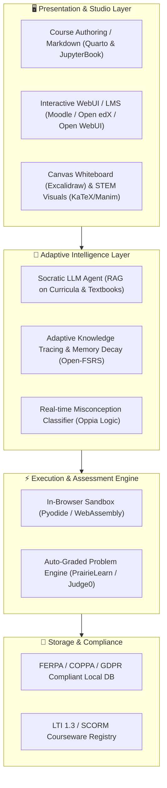

# 🎓 Awesome EdTech & Interactive AI Learning Studio

  <strong>A curated collection of industry-leading SaaS platforms and open-source GitHub projects powering next-generation AI tutoring, adaptive learning engines, interactive courseware studios, and self-hosted LMS architectures.</strong>

  
  
  
  
  

  <a href="#-saashosted-platforms">SaaS Platforms</a> •
  <a href="#-open-source-github-projects">Open-Source Projects</a> •
  <a href="#-interactive-sandboxes--stem-tools">Sandboxes & STEM</a> •
  <a href="#-core-architecture-frameworks">Studio Architecture</a> •
  <a href="#-how-to-contribute">Contribute</a>

---

## 📌 Overview & Scope

The modern educational landscape is rapidly evolving from static digital textbooks into **AI-native learning studios** and **adaptive mastery ecosystems**. This repository curates state-of-the-art tools and frameworks across:

- 🤖 **Socratic AI Tutors & Conversational Coaches**: Intelligent teaching assistants offering step-by-step guidance without hallucinating answers.
- 📈 **Cognitive Mastery & Adaptive Engines**: Algorithms adjusting pacing, scaffolding, and difficulty based on real-time student performance (e.g., FSRS, Bayesian Knowledge Tracing).
- 💻 **Interactive Browser Sandboxes**: Zero-install Python, Linux, and JavaScript sandboxes with automated unit tests and instant auto-grading.
- 🏛️ **Self-Hosted Open-Source LMS**: Full data sovereignty, zero per-student licensing fees, and compliance with institutional standards (FERPA, COPPA, GDPR, LTI 1.3, SCORM).
- 🎬 **AI Educational Media & Lecture Generation**: Text-to-speech lecture synthesizers, avatar video generators, and programmatic math animation tools.

---

## 📑 Table of Contents

- [📌 Overview & Scope](#-overview--scope)
- [☁️ SaaS/Hosted Platforms](#️-saashosted-platforms)
- [💻 Open-Source GitHub Projects](#-open-source-github-projects)
  - [🏢 Open-Source Learning Management Systems (LMS)](#-open-source-learning-management-systems-lms)
  - [🧠 AI Learning Studios, Tutors & Knowledge Assistants](#-ai-learning-studios-tutors--knowledge-assistants)
  - [🔄 Spaced-Repetition & Memory Retention Engines](#-spaced-repetition--memory-retention-engines)
  - [📖 Interactive Courseware & Open Textbooks](#-interactive-courseware--open-textbooks)
  - [📐 STEM, Math Animation & Problem-Driven Assessment](#-stem-math-animation--problem-driven-assessment)
- [🛠️ Interactive Sandboxes & STEM Tools](#️-interactive-sandboxes--stem-tools)
- [🏗️ Core Architecture Frameworks](#️-core-architecture-frameworks)
- [🤝 How to Contribute](#-how-to-contribute)
- [⚖️ License & Disclaimer](#️-license--disclaimer)

---

## ☁️ SaaS/Hosted Platforms

Industry-leading commercial and non-profit hosted EdTech studios, AI tutoring suites, and adaptive courseware platforms:

| 🏷️ Product | 💡 Key Focus & Capabilities | 💰 Pricing & Free Tier Limits |
| :--- | :--- | :--- |
| **[Khan Academy & Khanmigo](https://khanacademy.org)** | Socratic AI tutor and teacher assistant integrated across interactive K–14 mastery math, science, and humanities exercises. | **Free** (core learning content is 100% free with unlimited student access); **Khanmigo AI** available free/donation-supported for teachers and $4/mo or school district licensing for students. |
| **[Coursera](https://coursera.org)** | University degrees, professional certificates, interactive coding labs, and AI study coach (Coursera Coach). | **Free tier available**: Audit thousands of courses for free (graded assignments & certificates require Coursera Plus at ~$59/mo or $399/yr; enterprise plans available). |
| **[Duolingo](https://duolingo.com)** | Gamified bite-sized language and math learning driven by spaced-repetition algorithms and Duolingo Max generative AI roleplays. | **Free tier available**: Ad-supported with daily hearts/energy limits; **Super Duolingo** at ~$6.99–$12.99/mo; **Duolingo Max** (AI roleplay & Explain My Answer) at ~$29.99/mo. |
| **[CENTURY Tech](https://century.tech)** | AI-driven adaptive learning engine merging cognitive neuroscience with machine learning for personalized learning pathways. | **Commercial / SaaS**: Custom enterprise & institutional pricing per school/college; pilot demo trials available upon request. |
| **[Querium](https://querium.com)** | Step-by-step AI tutoring and diagnostic feedback for high-school and college STEM subjects (StepWise AI engine). | **Commercial / B2B SaaS**: Licensed to schools, textbook publishers, and colleges; institutional demo available. |
| **[Knewton Alta (Wiley)](https://wiley.com)** | Mastery-based adaptive courseware for higher-education STEM, economics, and statistics delivering real-time remediation. | **Commercial**: ~$39.95 per student per course (or ~$9.95/mo subscription model; institutional bookstore billing available). |
| **[Carnegie Learning (MATHia)](https://carnegielearning.com)** | Intelligent cognitive tutoring software modeling student learning trajectories and providing personalized mathematical hints. | **Commercial / District Licensing**: Contract pricing per student/school; includes digital textbook integration and professional development. |
| **[DreamBox Learning](https://dreambox.com)** | Dual-discipline adaptive math and reading platform continuously analyzing in-lesson problem-solving strategies. | **Subscription / Institutional**: Family plan ~$12.95/mo (free 14-day trial); custom district-wide annual licensing for K–8 schools. |
| **[Sana Labs](https://sanalabs.com)** | AI-native enterprise learning studio combining personalized adaptive pathways, course authoring, and RAG knowledge assistants. | **Freemium / Commercial**: Free trial available for small teams; Enterprise custom tiers based on active users and workspace seats. |
| **[Synthesia Education](https://synthesia.io)** | Generative AI video studio turning curriculum text and scripts into avatar-led, multilingual educational video lessons. | **Commercial SaaS**: Starter tier at ~$29/mo (includes 120 mins video/yr and 1 editor seat); Creator tier at ~$89/mo; custom enterprise plans for educational organizations. |

---

## 💻 Open-Source GitHub Projects

Explore battle-tested open-source learning systems, self-hosted AI tutoring platforms, and interactive textbook tools to maintain 100% data ownership and eliminate per-seat licensing fees.

### 🏢 Open-Source Learning Management Systems (LMS)

- **[Moodle (`moodle/moodle`)](https://github.com/moodle/moodle)** 🎓  
  *The world's most ubiquitous open-source Learning Management System.* Features modular course creation, competency-based tracking, grading workflows, LTI 1.3 standards, and an extensive ecosystem of community plugins (including OpenAI and local LLM tutor integrations).
- **[Open edX (`openedx/edx-platform`)](https://github.com/openedx/edx-platform)** 🌐  
  *Scalable, enterprise-grade MOOC platform founded by Harvard and MIT.* Powers millions of online learners worldwide with modular XBlocks, auto-graded coding problem sets, discussion forums, and rich institutional learning analytics.
- **[Canvas LMS (`instructure/canvas-lms`)](https://github.com/instructure/canvas-lms)** 🏫  
  *Modern open-source core behind higher-ed and K–12 institutions.* Provides an intuitive web UI, mobile apps, rubrics, speed-grader workflows, and deep external tool interoperability.
- **[Kolibri (`learningequality/kolibri`)](https://github.com/learningequality/kolibri)** 📡  
  *Offline-first educational studio and LMS engineered for low-connectivity environments.* Distributes curated Khan Academy, OpenStax, and custom interactive exercises over local Wi-Fi without internet access.
- **[Chamilo LMS (`chamilo/chamilo-lms`)](https://github.com/chamilo/chamilo-lms)** 📑  
  *Lightweight, accessible e-learning system.* Emphasizes fast course authoring, SCORM compliance, skill-based tracking, and straightforward classroom administration.
- **[Sakai (`sakaiproject/sakai`)](https://github.com/sakaiproject/sakai)** 🏛️  
  *University-designed open-source learning environment.* Built specifically for higher education teaching, academic research collaboration, and comprehensive grading rubrics.

### 🧠 AI Learning Studios, Tutors & Knowledge Assistants

- **[Ekko Studio (`EKKOLearnAI/ekko-studio`)](https://github.com)** 🤖  
  *Modern open-source interactive AI learning studio.* Designed for building AI-assisted tutoring experiences, dynamic question generation, and adaptive study workflows.
- **[Open WebUI (`open-webui/open-webui`)](https://github.com/open-webui/open-webui)** 💬  
  *Self-hosted AI workspace with multimodal support.* Frequently deployed by educators and university labs to host Socratic AI tutors, local RAG textbook query engines, and voice tutoring agents with local LLMs (Ollama/vLLM).
- **[Oppia (`oppia/oppia`)](https://github.com/oppia/oppia)** 💡  
  *Interactive conversational learning platform.* Delivers story-driven learning explorations that simulate one-on-one tutoring by directly diagnosing and addressing specific student misconceptions.
- **[Open Notebook (`lfnovo/open-notebook`)](https://github.com/lfnovo/open-notebook)** 📓  
  *Privacy-first open-source alternative to Google NotebookLM.* Enables students and teachers to upload lecture slides and textbooks, chat with synthesized notes, and produce auto-generated audio discussions.
- **[SurfSense (`MODSetter/SurfSense`)](https://github.com/MODSetter/SurfSense)** 🔍  
  *Self-hosted AI research and knowledge engine.* Unifies research papers, lecture notes, and web references into an interactive, vectorized study workspace.
- **[Khoj (`khoj-ai/khoj`)](https://github.com/khoj-ai/khoj)** 🧭  
  *Personal open-source AI study companion.* Indexes local Obsidian, Markdown, and PDF notes to craft custom adaptive quizzes, flashcards, and factual research assistants.

### 🔄 Spaced-Repetition & Memory Retention Engines

- **[Anki (`ankitects/anki`)](https://github.com/ankitects/anki)** 🗂️  
  *The gold standard in active-recall and spaced-repetition software.* Cross-platform flashcard system supporting LaTeX, audio clips, image occlusion, and modern neural retention models.
- **[Open-FSRS (`open-spaced-repetition/fsrs4anki`)](https://github.com/open-spaced-repetition/fsrs4anki)** 📈  
  *Free Spaced Repetition Scheduler (FSRS).* Machine-learning-based scheduling algorithm mathematically modeling memory decay to reduce review counts by 20–30% compared to traditional SM-2.
- **[Logseq (`logseq/logseq`)](https://github.com/logseq/logseq)** 🧠  
  *Privacy-centric, local-first knowledge graph.* Combines networked note-taking with built-in spaced-repetition flashcards and side-by-side PDF annotation for deep academic study.

### 📖 Interactive Courseware & Open Textbooks

- **[freeCodeCamp (`freeCodeCamp/freeCodeCamp`)](https://github.com/freeCodeCamp/freeCodeCamp)** 💻  
  *World-renowned open-source interactive coding and math learning platform.* Features full in-browser coding environments, automated unit test validation, and structured project certifications.
- **[H5P (`h5p/h5p-php-library`)](https://github.com/h5p/h5p-php-library)** 🧩  
  *Open-source HTML5 authoring library.* Enables teachers to create rich interactive videos, branching scenarios, crosswords, and drag-and-drop exercises directly within any LMS.
- **[JupyterBook (`jupyter-book/jupyter-book`)](https://github.com/jupyter-book/jupyter-book)** 📚  
  *Publication tool for computational courseware.* Compiles Jupyter Notebooks and Markdown into interactive, publication-quality online textbooks with embedded live code cells.
- **[Quarto (`quarto-dev/quarto-cli`)](https://github.com/quarto-dev/quarto-cli)** 📊  
  *Next-generation scientific publishing system.* Creates interactive technical websites, slides, and WebAssembly-powered executable lessons from plain Markdown.
- **[LibreTexts / Adapt (`LibreTexts/adapt`)](https://github.com/LibreTexts/adapt)** 📖  
  *Open-source adaptive homework and assessment system.* Integrates auto-graded STEM questions, OER textbooks, and formative evaluation across multi-campus networks.

### 📐 STEM, Math Animation & Problem-Driven Assessment

- **[PrairieLearn (`PrairieLearn/PrairieLearn`)](https://github.com/PrairieLearn/PrairieLearn)** 📝  
  *Problem-driven online homework and exam platform originated at UIUC.* Generates randomized, parameter-driven engineering, math, and computer science problem sets with instant auto-grading.
- **[Manim (`ManimCommunity/manim`)](https://github.com/ManimCommunity/manim)** 🎬  
  *Python animation engine for explanatory math and physics.* Programmatically generates smooth vector animations and visual proofs popularized by 3Blue1Brown.
- **[Excalidraw (`excalidraw/excalidraw`)](https://github.com/excalidraw/excalidraw)** 🎨  
  *Virtual hand-drawn collaborative whiteboard.* Widely embedded in live digital tutoring environments, collaborative problem solving, and visual diagramming.
- **[SCORM API Wrapper (`pipwerks/scorm-api-wrapper`)](https://github.com/pipwerks/scorm-api-wrapper)** 📦  
  *Standardized e-learning wrapper.* Provides clean JavaScript abstractions to connect interactive modules and courseware with SCORM 1.2 and SCORM 2004 LMS engines.

---

## 🛠️ Interactive Sandboxes & STEM Tools

Essential open-source libraries for running client-side compilers, math rendering, and digital classroom features:

- 🐍 **In-Browser Code Sandboxes**: [Pyodide](https://github.com/pyodide/pyodide) (Python in WebAssembly), [WebVM](https://github.com/leaningtech/webvm) (client-side Linux virtualization), and [Judge0](https://github.com/judge0/judge0) (multi-language remote code execution system).
- 🎙️ **Virtual Classrooms & Lecture Capture**: [BigBlueButton](https://github.com/bigbluebutton/bigbluebutton) (open-source web conferencing designed for online classrooms) and [Opencast](https://github.com/opencast/opencast) (automated lecture recording and scheduling).
- 🗣️ **Open-Source Speech & Avatar Generation**: [Whisper](https://github.com/openai/whisper) (high-accuracy audio transcription for pronunciation analysis), [Kokoro TTS](https://github.com/hexgrad/kokoro) (lightweight, rapid text-to-speech), [Piper](https://github.com/rhasspy/piper), and [SadTalker](https://github.com/OpenTalker/SadTalker).
- 📐 **Math & Physics Rendering**: [KaTeX](https://github.com/KaTeX/KaTeX) (lightning-fast LaTeX math rendering for the web) and [GeoGebra](https://github.com/geogebra/geogebra) (interactive geometry and algebra engine).

---

## 🏗️ Core Architecture Frameworks

Building a production-ready, self-hosted AI Learning Studio from open-source building blocks:

> 💡 **Recommended Stack**: Combine **Open WebUI** or **Moodle** (course delivery) + **Pyodide** / **Judge0** (safe code sandboxing) + **FSRS** (optimized memory intervals) + **KaTeX** / **Manim** (visual explanations) for a robust, zero-license-cost learning platform.

---

## 🤝 How to Contribute

We welcome contributions from educators, software engineers, and instructional designers!

1. 🍴 **Fork the repository**.
2. 🌿 **Create a descriptive feature branch** (`git checkout -b feature/add-new-tool`).
3. 📝 **Add or edit entries in `README.md`**:
   - Provide the project/tool name with official link.
   - For SaaS tools, make sure to detail pricing and free tier boundaries.
   - For open-source tools, link directly to the GitHub repository.
   - Keep descriptions factual, pedagogical, and concise (1–2 sentences).
4. ✅ **Ensure markdown formatting and links are valid**.
5. 🚀 **Submit a Pull Request** with a brief summary of the submission.

---

## ⚖️ License & Disclaimer

- 📖 **License**: This curated directory is made available under the [Creative Commons Zero v1.0 Universal (CC0 1.0)](https://creativecommons.org/publicdomain/zero/1.0/) dedication.
- 🔒 **Data Privacy & Compliance**: Any platform collecting student interactions, voice, or grades must strictly adhere to regional student privacy frameworks such as **FERPA**, **COPPA**, and **GDPR**.
- ⚠️ **Pedagogical Disclaimer**: AI tutoring models can occasionally output hallucinated information. Educational tools should always be paired with human oversight, validated curricula, and structured rubric evaluations.

  Built with ❤️ for educators, researchers, EdTech innovators, and lifelong learners worldwide.

